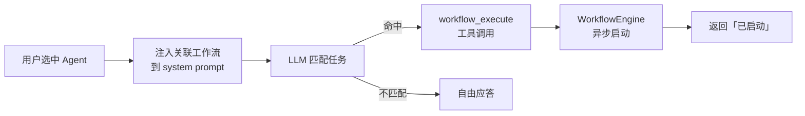
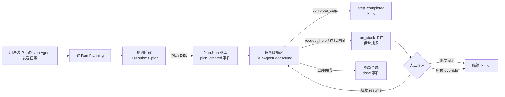

# 021 · AI 智能体（AI Agent）

> 状态：已实现（代码中已落地）
> 最后更新：2026-09-21

## 概述

AI 智能体编排框架：多 Agent 协调与执行（`AgentsController`）、智能规划建议（`PlanningController`）、AI 辅助工作流（`AIWorkflowController`，见 013）、脚本生成与错误分析（`AIScriptController`）、AI 聊天（`AIChatController`）。是连接「统一 AI 网关」与「上层工具」的协调层。

## 代码落点

| 层 | 文件 |
|----|------|
| 控制器 | `Plugins/AIAgent/Controllers/`：`AgentsController.cs`（`[Route("api/agents")]`）、`PlanningController.cs`（`[Route("api/planning")]`）、`AIWorkflowController.cs`（`[Route("api/ai-agent/workflow")]`）、`AIScriptController.cs`（`[Route("api/ai-agent/script")]`）、`AIChatController.cs`（`[Route("api/ai-agent/chat")]`）、`ProjectController.cs`（`[Route("api/project")]`） |
| 服务 | `Plugins/AIAgent/Services/`：`AIAgentService`（Agent 编排入口；循环运行时现委派统一 `ReactLoopAgent` 状态机驱动，`RunAgentLoopAsync` 为历史命名，详见 dsh 对齐 B5）、`AgentRegistryService`（Agent 定义加载 + 空表 seed 内置 Agent）、`AgentExecutorService`、`AgentCoordinatorService`、`WorkflowPlannerService`、`AIWorkflowAssistant`、`ProactivePlanningService`、`ProjectWorkspaceService` 等 |
| 模型 | `Plugins/AIAgent/Models/AgentModels.cs`（`AgentDefinition` / `AgentWorkflowRef` / 任务与实例模型）、`SkillDefinition.cs` |
| 数据 | `Plugins/AIAgent/Data/`：XCode 实体 `AgentDefinition`（含 `ConfigJson` 持久化人格/工具/工作流关联）、`AIChatMessage`（连接名 `AIAgent`，`Model.xml` 生成模式） |
| 前端视图 | 插件自带界面 `Plugins/AIAgent/web/`（`plugin.json.frontend.route = /ai-agent`）：`AiAgentView` + `SessionPanel`（会话/Agent 列表）/ `ChatPanel`（对话 + composer）/ `ContextPanel`（AI 上下文）/ `AgentEditDialog`（Agent 编辑）；宿主残留 `src/views/AgentsManageView.vue`（管理视图） |
| 前端服务 | 插件 `web/src/http.ts`（自带 token 直连后端）、`web/src/types.ts` |

## 核心 API

**`api/agents`**：列表 / 详情 / 按类型 / `find` / `best-match` / `coordinate` / `execute` / `handle` / `execute-task`；实例管理 `instances[/{instanceId}]`；CRUD `POST /`、`PUT {agentId}`、`DELETE {agentId}`（v1.6.5 起，AgentDefinition 入库后开放）。

**`api/planning`**：`suggestions`、`suggestions/pending`、`suggestions/{id}/action|dismiss`、`patterns`、`profile`、`skills`、`preferences`、`event`。

**`api/ai-agent/workflow`**：`plan`、`plan/prompt`、`execute`、`{executionId}/status`、`tools/match`（详见 013）。

**`api/ai-agent/script`**：`generate`、`analyze-error`、`suggest-fix`、`templates[/{templateId}]`、`templates/categories`。

**`api/ai-agent/chat`**：`POST /`、`POST /stream`（SSE：content / **turn** / tool_call / tool_result / usage / done）、`history/{sessionId}`、`DELETE session/{sessionId}`、`tools`、`GET /sessions`（按 `SessionId` 聚合的历史会话列表：`sessionId`/`title`/`messageCount`/`lastTime`，标题取首条 user 消息前 20 字，直查库不走缓存）。

## 会话管理（T2，2026-09-21）

聊天界面 `SessionPanel` 新增「历史会话」分组：拉 `GET /sessions` 渲染列表，点击切换原样回传**全 id**（`sessionId`）调 `history/{sessionId}` 重载上下文；删除走 `DELETE session/{sessionId}`（删当前则新建会话）。切换一律用全 id，**规避早期「切回历史会话用短 id 查询得 0 条」的断裂**（T3 根因：两段式 id 仅在存储侧一致，前端统一传全 id 即可消除回归）。

## 自治循环（Agent Loop，v1.6.19）

**背景（2026-09-21 根因修复）**：`RunAgentLoopAsync` 原先把「本轮无 tool_call」等同于「任务完成」→ 立即 `done` + `yield break`。弱模型常先输出一段计划文本，于是**每轮都在第一次纯文本输出处熔断**，用户被迫手动连发「继续」。

**修复后的循环契约**：

| 概念 | 说明 |
|------|------|
| 自治模式判定 | `enableTools && maxTurns > 1`（`ChatRequest.MaxTurns` 未传 → `DefaultAutonomousMaxTurns = 20`；传 `1` → 传统单次问答，行为不变） |
| 完成出口 | 模型调用 **`finish`** 工具（`Id = aiagent.finish`，schema `{ summary }`）→ `stopReason = "finish"` 并结束 |
| 强制挂载 | 自治模式下 `finish` **不受 `enabledToolNames` 白名单过滤**（循环控制工具而非能力工具；被过滤会导致模型永远无法声明完成，必然跑满上限） |
| 自动续跑 | 本轮无 tool_call 且未调 `finish` → 注入 `AutoContinuePrompt` 续跑指令，进入下一轮 |
| 硬边界 | 达到 `maxTurns` → `stopReason = "max_turns"`，如实回报轮次 |
| 系统提示词 | 自治模式追加 `AutonomousLoopContract`，告知模型「只有 finish 才结束，否则自动续跑」 |

**可观测字段**（`AgentLoopEvent`）：`Turns`（当前轮次）/ `MaxTurns`（上限）/ `StopReason`（`finish` \| `max_turns` \| `completed` \| `max_iterations`）。

`stopReason` 语义：`finish` = 模型主动声明完成；`max_turns` = 自治模式跑满轮次上限；`completed` = 非自治模式无工具调用即终答；`max_iterations` = 非自治模式达工具迭代上限。

**SSE `turn` 事件**：`{ type: "turn", content: "第 N/M 轮未声明完成，自动续跑" | "第 N/M 轮结束", turns, maxTurns }`，供前端展示循环进度。

**前端展示**：`AiAgentView` 的 `loopProgress` 驱动 `ChatPanel` 状态位显示「第 N/M 轮」；循环结束显示徽标「共 N/M 轮」；`stopReason === "max_turns"` 时提示「已达自主循环上限…任务可能尚未完成——可再发消息继续」。

**计划驱动循环不受影响**：`PlanGeneratorService` / `RunOrchestratorService`（B7 升格后为编排薄壳，步骤执行由统一 `ReactLoopAgent` 状态机承担，原 `StepRunLoopService` 已删除）走 `maxTurns = 1` + `extraTools` 显式挂载 `submit_plan` / `complete_step` / `request_help`，行为与修复前完全一致。

**ReactLoopAgent（dsh B5，循环运行时现状）**：Agent 循环由 AIAgent 插件 `ReactLoopAgent`（实现 `IAgent`，经 `IAgentRegistry` 按会话解析）驱动——九态 turn/step 帧联合推进；工具调度走宿主 `IToolRegistry.ExecuteBatchAsync`（model-ordered commit：N 个 call 必有 N 个 result，取消合成 Skipped）；出口工具（complete_step/request_help）分区直达；step 超时看门狗将 turn 挂起（`TurnEndReason.Suspended`），steer 后恢复；followup/steer/inject 三语义经 `IInbox` 注入。详见 dsh 三部曲设计（`specs/040..042` 与 [`ai/pilot/dsh-alignment-b2-b9/02-spec.md`](../ai/pilot/dsh-alignment-b2-b9/02-spec.md)，上下文真源与收官报告在该 pilot 目录 00–07）；运行时架构图见 [`dsh-runtime-architecture.md`](dsh-runtime-architecture.md)。

**验证**：单测 `ForgeSelf.Api.Tests/Plugins/FinishToolTests.cs`（14 用例）+ `web/src/http.test.ts`（5 用例，SSE 分片解析）；e2e `e2e/plugins/ai-agent/agent-loop-autonomous.spec.ts`（4 用例，覆盖 `completed` / `finish` / `max_turns` 三条出口）。

**`api/project`**：工作目录选择 / 文件列表 / 读写（MCP 工具 `aiagent.list_files/read_file/write_file`，见 028）；目录浏览 `GET browse-directories?path=`（磁盘级逐级浏览，供前端目录选择弹窗与「浏览」按钮使用）。

## Agent 可配置项（AgentDefinition，v1.6.5–v1.6.7）

Agent 定义为 XCode 实体（空表时 seed 7 个内置 Agent），`AgentEditDialog` 支持编辑：

- 基本信息：名称 / 头像 / 描述 / 类型 / 排序 / 最大迭代 / 启用开关
- 系统提示词（SystemPrompt）
- 五维能力画像：创造力 / 分析力 / 同理心 / 自信度 / 正式度
- 擅长领域 / 能力 / 工具 / 局限性（TagInput 多值）
- 关联工作流（见下节）

## Agent 关联工作流（v1.6.7）

Agent 可关联多个 WorkflowEngine 工作流，执行时注入提示词，由 LLM 用 `workflow_execute` 工具按需调用（2026-10-28 命名空间统一前名 `execute_workflow`，旧 AIAgent 侧同名副本已随归属迁移删除）。

**数据模型**：`AgentDefinition.Workflows`（`List<AgentWorkflowRef>`：`WorkflowId` + 冗余 `Name`/`Description`），随 `ConfigJson` 持久化（`AgentDefinition.Biz.cs` ToModel/FromModel 透传），零迁移。

**关联 UI**：`AgentEditDialog.vue`「关联工作流」区块 —— 多选下拉（`fetchWorkflows` 拉 `api/workflows?page=1&pageSize=200`）+ 已关联 chips + 空态降级（无工作流时提示）。

**执行期注入**：`AIAgentService.AppendAssociatedWorkflows` 在每轮 agent 循环前把「## 本 Agent 关联的工作流」追加进 system prompt，提示 LLM：任务匹配某工作流时调 `workflow_execute(workflowId, inputVariables)`，不匹配不强行调用。

**执行工具**：`ExecuteWorkflowToolFunction`（Id `workflow.tool.execute`，Name `workflow_execute`，[WorkflowEnginePlugin.cs:120](../../Plugins/WorkflowEngine/WorkflowEnginePlugin.cs)）——经 `IWorkflowService` 启动工作流执行。

**已知限制（记录于 2026-09-09，后续由 spec 029 解决）**：

1. `workflow_execute` 为**异步启动即返回**：不等工作流终态、不校验步骤、不回注结果 → LLM 可在流程未完成时宣称完成，**无走完保证**。
2. 无步骤级完成度校验（多工作流取舍、步骤推进均靠 LLM 自决）。

**回归保护**：`ForgeSelf.Web/e2e/plugins/ai-agent/ai-agent.spec.ts` 含「关联工作流区块渲染」用例（多选/空态二选一 + 无 5xx 护栏）。

## 使用要点

- Agent 协调依赖 `AgentCoordinatorService`，可编排多个子 Agent 完成任务。
- `PlanningController` 基于历史行为给出主动性建议（见 `preferences`/`patterns`）。
- 聊天会话复用统一 `ChatSession` 聚合（见 010）。
- 工具白名单（`enabledToolNames`）与技能注入（`skillIds`）随聊天请求传递（v1.5.5 工作台重构）。
- 执行模式（`executionMode`）：`free`（自由循环，默认）/ `plan`（计划驱动），随 `AgentDefinition.ConfigJson` 持久化（v1.6.7，见下节）。

## 计划驱动执行引擎（v1.6.7–v1.6.9 · spec 029）

Agent 可配置执行模式为「计划驱动 PlanDriven」：任务先规划（Plan DSL）再逐步执行，代码逐步驱动 LLM（`complete_step` 推进 / `request_help` 卡住），全部步骤留痕可复盘，卡住可人工介入（跳过/补位/继续），支持中断后续跑。

### 数据模型（XCode 双表，连接名 `AIAgent`）

| 表 | 字段要点 |
|----|----------|
| `AgentRun` | 执行实例：`AgentId`/`SessionId`/`TaskInput`/`PlanJson`（Plan DSL）/`StepCount`/`CurrentStepIndex`/`Status`（Pending→Planning→Running→Completed/Stuck/Failed/Cancelled）/`StuckReason`/`TotalTokens` |
| `AgentStepRun` | 步骤明细：`RunId`+`StepIndex`（唯一）/`StepId`/`Name`/`Objective`/`InputJson`/`OutputJson`/`ToolCallsJson`/`StuckReason`/`HumanNote`/`HumanOverride`/`RetryCount`/`TokensUsed`/`DurationMs` |

**Plan DSL**（存 `AgentRun.PlanJson`）：`{ goal, steps[] }`，每步 `{ id, name, objective, expectedOutput, allowedTools, mandatory }`；`mandatory` V1 先埋不启用（D5）。

### 执行流程（RunOrchestrator）

### 模式配置与入口

- **执行模式开关**：`AgentEditDialog.vue`「执行模式」radio（自由循环 FreeLoop / 计划驱动 PlanDriven）→ 写 `AgentDefinition.ConfigJson.ExecutionMode`（`free` 默认，缺省向后兼容）。
- **前端分流**：`AiAgentView.sendMessage` 依据激活 Agent 的 `executionMode`——`plan` 走 `POST /api/ai-agent/runs`（SSE 流），`free` 走既有聊天流。
- **步骤进度卡** `StepProgressCard.vue`：与消息流并列常驻，消费 `plan_created/step_started/step_completed/run_stuck` SSE 事件，折叠展示目标/产出/卡住原因。
- **执行记录面板** `RunRecordPanel.vue`：中栏右上「执行记录」按钮打开——Run 列表（状态徽标）+ 详情（步骤时间线、入参出参、卡住原因）+ 操作（继续/重开/跳过/补位/取消）。

### 核心 API（`api/ai-agent/runs`，`AgentRunsController`）

| 端点 | 说明 |
|------|------|
| `POST /` | 创建并驱动执行（SSE 流：`plan_created`/`step_started`/`step_completed`/`run_stuck`/`content`/`tool_call`/`tool_result`/`usage`/`error`/`done`） |
| `GET /` | Run 列表（分页 + `sessionId`/`status` 过滤，`RetrieveTotalCount=true`） |
| `GET /{id}` / `GET /{id}/detail` | Run 摘要 / 详情（含步骤列表） |
| `POST /{id}/resume` | 恢复执行（仅 Stuck/Failed，从 `CurrentStepIndex` 续跑，SSE 流） |
| `POST /{id}/restart` | 同 Plan 新建 Run 从头执行 |
| `POST /{id}/cancel` | 取消（终态拒绝） |
| `PATCH /{id}/steps/{index}` | 人工介入（`skip` 跳过 / `override` 补位，`HumanNote` 批注） |

**特殊工具**（仅 PlanDriven 步骤循环挂载，不进 FreeLoop）：`submit_plan`（规划器提交 Plan）、`complete_step`（步骤完成声明）、`request_help`（卡住求助）。

> **status 字段契约**（v1.6.9 实测对齐）：`AgentRunDto.status` / `AgentStepRunDto.status` 经 System.Text.Json **默认序列化为 int**（枚举序号，非字符串名）。前端 `web/src/types.ts` 的 `runStatusName`/`stepStatusName` 统一做 int→小写语义映射；`status` 过滤查询参数同样传 int。详见 `specs/029-agent-plan-driven-execution/contracts/agent-runs-api.md` §8。

### 回归保护

`ForgeSelf.Web/e2e/plugins/ai-agent/ai-agent.spec.ts` 含「执行模式开关持久化」「计划驱动执行全链路」（runs SSE + 步骤卡 + 执行记录面板）用例（真实后端，零 mock）。

## 万能工具网关与命令执行工具（v1.6.10 · spec 031）

Agent 侧新增两个工具（实现在 `Plugins/AIAgent/Services/ToolFunctions/`，经 `AIAgentPlugin.RegisterToolFunctionExtensions` 注册进宿主 ToolRegistry）：

| 工具 | 形态 | 说明 |
|------|------|------|
| `universal_tool` | 分发透传壳 | 入参 `{tool, parameters}` → 经宿主 `IToolRegistry.ExecuteAsync(new ToolExecution{...})` 六闸门执行面分发到真实工具，结果原样透传；防自引用（拒绝转发自身）、unknown 带已注册数量提示。FreeLoop 白名单外的宿主全量工具可经它触达，事件链（pre-execute 三态/守卫/execute/post-execute）/使用统计全部照走，不扩权 |
| `run_terminal_command` | 独立命令工具 | 三道安全门：可执行名白名单（仅放行 `dotnet/pnpm/node/git/ssh/pwsh`）；**管道/链式已放开（PILOT-075，2026-10-29）**：`\|` `;` `&&` `\|\|` 换行是分隔符而非拒绝理由，**每一段独立过同一套白名单+破坏性红线**（用户原话「每一个管道或者链式，应都走同样的拦截校验」），任一段被拒则整条拒绝且零子进程（段数>1 时原因带 `segment i/n` 前缀）；多段命令经 `pwsh -NoProfile -NonInteractive -Command` 执行完整命令串（退出码取最后一段）；重定向（`>` `<`）、反引号、后台单 `&`、空段、引号不配对仍整串拒绝。cwd 必填（绝对路径、目录须存在；不再回退登记项目根，2026-10-29）。破坏性命令红线（删除/格式化/联网类）拒绝路径零子进程。stdout/stderr/exitCode 回传 50KB 截断，默认 30s 超时。输出解码（PILOT-073/PC-011）：读 BaseStream 原始字节交 `ForgeSelf.Core/ProcessOutputText` 裁决（严格 UTF-8→系统 ANSI 回退+往返校验），不再固定码页解码；真源 `docs/11-troubleshooting/problem-classes/PC-011-process-output-fixed-codepage-decode.md` |

- 设计依据：`specs/031-universal-tool-gateway/`（design §2：复用 ToolRegistry 分发核，宿主零修改）+ 决策台账 ADR-002（`docs/07-decisions/002-universal-tool-gateway.md`）。
- 模型侧可见性：两工具随插件注册自动进入 FreeLoop（历史教训：77 工具全挂上游 400，故只挂 13+2 个定义，其余经 `universal_tool` 转发）。
- 单测：`ForgeSelf.Api.Tests/Plugins/` 下 `UniversalToolTests`（12 用例：双形态解析/透传/自引用/unknown 计数/软依赖兜底）+ `TerminalCommandGuardTests`（白名单/链式注入/越界/红线 + PILOT-075 分段器与逐段校验用例）+ `RunTerminalCommandChainExecutionTests`（PILOT-075：多段经 pwsh 真执行/管道通数据/段级拒绝零子进程）+ `RunTerminalCommandEncodingTests`（GBK/UTF-8 子进程输出中文完好，PC-011 红灯锚）。

## 工具清单（Agent 可见工具全量盘点 · 2026-10-28 命名空间统一后实测读码）

> 本节是「AI agent 能看到/能调用哪些工具」的**唯一真源**。工具不由 AI agent 单独导出，而是各插件以 `IToolFunctionExtension` 注册进宿主 ToolRegistry（`ForgeSelf.Api/Services/ToolRegistry.cs:46`，按 `Name` 键 `TryAdd`，重名先到先得、后到告警注册失败），agent 经注册表取用（`AIAgentService.ResolveToolDefinitions`，AIAgentService.cs:602）。运行期实时枚举入口：`GET /api/ai-agent/chat/tools`（AIChatController.cs:478）或 `universal_tool {"tool":"list_tools"}`。
>
> **2026-10-28 命名空间统一（ADR-004，pilot `2026-10-28-tool-namespace-ownership`）**：全部插件工具改 `<toolPrefix>_<语义名>` 或命中平台保留名白名单；**mcp-center 整插件豁免前缀**（用户拍板 2026-10-28 17:29「mcp中心的工具不用前缀，是特殊例外」，`ToolNamespace.ExemptPluginId`）——其工具名即公共 API 面；公共基础工具迁 mcp-center；81 个旧名即退役（无别名层，`ToolNamespace.RenameMap` 为对账唯一真源）；注册口 `ExtensionPointManager` 校验违规即拒。

**四层可见性**：
1. **FreeLoop 默认挂载**（不勾选工具时）：仅本插件 + memory-system + design-system 三个插件的作用域（`ToolScopePluginIds`，AIAgentService.cs:579），并剔除计划流三工具。
2. **显式勾选（composer 🔧 / Agent 白名单）**：候选池放开到全注册表（`ResolveSelectableToolDefinitions`，AIAgentService.cs:599）。
3. **白名单外工具**：经 `universal_tool` 按名转发触达；工具名不确定先 `search_tools` 检索，再 `list_tools` 全量枚举兜底。
4. **不进注册表的**：`finish`（循环控制工具，运行期构造挂载，FinishToolFunction.cs:95）；外部 MCP 工具（决策 D10，不注册，经 `universal_tool` 以 `mcp.<服务器id>.<工具名>` 调用）。

**各插件工具清单**（工具数按源码 `Name` 实测；† = 运行期显式挂载、仍占注册表）：

| 插件 | 数 | 工具名 |
|------|----|--------|
| AIAgent | 4 | `aiagent_plan_workflow` `submit_plan`† `complete_step`† `request_help`† |
| McpCenter | 6 | `universal_tool` `search_tools` `list_tools` `run_terminal_command`（前 4 为平台保留名）+ `get_current_time` `calculate`（整插件豁免前缀，用原名）。**2026-10-28 归属修订轮**：文件三件套（read_file/write_file/list_files）实现迁 FileTools（名字仍为保留名，mcp-center 只留网关+发现+公共小工具面） |
| WorkflowEngine | 5 | `workflow_create` `workflow_get` `workflow_execute` `workflow_get_status` `workflow_list` |
| MemorySystem | 5 | `memory_relevant` `memory_add` `memory_search` `memory_update` `memory_stats` |
| DesignSystem | 8 | `design_guide` `design_context` `design_lookup` `design_review` `design_audit` `design_presets` `design_create` `design_edit` |
| DevTools | 27 | `dev_format_json` `dev_validate_json` `dev_convert_json_yaml` `dev_jsonpath_query` `dev_format_xml` `dev_base64_encode` `dev_base64_decode` `dev_url_encode` `dev_url_decode` `dev_hash` `dev_hmac` `dev_aes_encrypt` `dev_aes_decrypt` `dev_regex_test` `dev_regex_generate` `dev_regex_replace` `dev_timestamp` `dev_color_convert` `dev_color_palette` `dev_color_contrast` `dev_jwt_decode` `dev_jwt_validate` `dev_jwt_generate` `dev_uuid` `dev_snowflake_id` `dev_qrcode` + `dev_text_stats`（2026-10-28 text-tools 整插件并入，用户拍板；text_base64_encode/decode、text_hash、text_format_json 由 dev 同功能承接退役，`text_stats` 改名 `dev_text_stats`） |
| ~~TextTools~~ | — | **已并入 DevTools**（2026-10-28 用户拍板 D-V1；宿主「文本工具」页面保留，后端归 DevTools） |
| FileTools | 9 | `file_rename` `file_cleanup` `file_compress` `file_stats` `file_extract` `file_dir_stats` + `read_file` `write_file` `list_files`（2026-10-28 归属修订轮自 McpCenter 迁入，名字维持平台保留名不变） |
| SystemMonitor | 5 | `sys_cpu` `sys_memory` `sys_disk` `sys_processes` `sys_kill_process` |
| ScriptRunner | 11 | `script_run` `script_list` `script_exec_code` `script_generate` `script_analyze_error` `script_suggest_fix` `script_templates` `script_snippet_list` `script_snippet_create` `script_personal_stats` `script_recommend` |
| QuickLinks | 4 | `link_search` `link_open` `link_categories` `link_create` |
| Scheduler | 3 | `schedule_create` `schedule_list` `schedule_pause` |
| TodoTracker | 8 | `todo_create` `todo_list` `todo_complete` `todo_task_get` `todo_task_claim` `todo_execution_append` `todo_stage_update` `todo_dispatch` |
| Sems | 22 | `sems_list_projects` `sems_register_project` `sems_update_project` `sems_remove_project` `sems_list_commands` `sems_add_command` `sems_update_command` `sems_delete_command` `sems_list_runs` `sems_check_runs` `sems_run_command` `sems_stop_command` `sems_stop_run` `sems_create_spec` `sems_add_spec_version` `sems_get_spec` `sems_list_specs` `sems_link_spec` `sems_list_spec_links` `sems_find_spec_by_ref` `sems_link_spec_case` `sems_get_spec_coverage` |
| AgentHub | 5 | `hub_list_agents` `hub_delegate_task` `hub_task_result` `hub_cancel_task` `hub_ask_agent` |
| SamplePlugin | 1 | `sample_greet`（演示用） |

合计 **124** 个工具注册（16 插件贡献；2026-10-28 归属修订轮：text-tools 并入 DevTools 净减 4（5 工具中 4 个与 dev 同功能退役、text_stats 改名 dev_text_stats）、文件三件套 McpCenter→FileTools 平移；公共基础工具仍归宿 mcp-center；e2e 宿主实测 [ToolRegistry] 注册日志核对）；另有 `finish`（循环控制）与外部 MCP 工具不占注册表。`ToolBridge` 插件是 HTTP 桥，不注册工具（D3，not-to-do 035）。**插件功能边界标准**（分类学/判定三问/消费≠实现铁律）见 `docs/04-standards/plugin-design-boundary.md`。

**重名冲突：已清零**。2026-10-27 盘点发现的 5 组裸名冲突（AIAgent vs WorkflowEngine 三组、DevTools vs TextTools 两组）随命名空间统一全部消除——每个名字唯一归属一个插件，且守卫 `ToolNamespaceGuardTests.S4_全注册表零重名` 常驻防复发。新增工具违反 `<toolPrefix>_` 规则会在注册口被拒（`ExtensionPointManager`）并在 CI 守卫即红。

## 后续演进

- **步骤完成度强校验**（V2，`mandatory` 出口校验）：触发条件 = V1 实测出现「谎报完成」案例（not-to-do 台账 006.1）。
- **`workflow_execute` 同步等终态**：异步启动即返回、无走完保证，已记 not-to-do 006.2，可独立小修先行。
- **Run 记录供给其他插件**（sems 看板等）：触发条件 = 第二消费方出现（not-to-do 006.5）。
