# 102 · 运行实况（人的注意力）

宿主页可见名是「运行实况」，路由仍是 `/task-center`。它把要你决定的审批，以及这个工具里正在跑的任务和命令收在一页。决定仍走各来源自己的接口，不另建审批库，不新建插件。

IM 进展推送保持原样。本页不发系统通知。IM 任务网关若已开启，阻塞审批仍走它现有的审批卡。

本文件是这条功能的需求与验收真源。工件只保留编号和证据等级，不另抄一份需求。截图在 `docs/ai/pilot/2026-11-25-attention-inbox/evidence/`。

## 验收总览

能在本机造出来的状态都有截图，等级为 Verified。造不出来的标 Unknown，不写成已验证。

| 编号 | 判定 | 证据 |
| --- | --- | --- |
| AC1 | 读取中只显示「正在读取」，页头不出现条数 0 | 有截图 |
| AC2 | 各路都空时说明现在没有要处理的，也没有在跑的 | 有截图 |
| AC3 | 页头和标签数字只计还没写下结果的阻塞审批 | 有截图 |
| AC4 | 第一张紧急审批的「同意」是金色填充，拒绝是朱红文字 | 有截图 |
| AC5 | 破坏性写入先确认；取消后仍待批 | 有截图 |
| AC6 | 同意后卡片留下「已同意，原任务继续」 | 有截图 |
| AC7 | 拒绝后卡片留下「已拒绝」 | 有截图 |
| AC8 | 外部 Agent 的同意是「只放行这一次」 | 有截图 |
| AC9 | 终端待批注明「本次宿主运行期间有效」 | 有截图 |
| AC10 | 在跑按项目名分组，全量列出，不出现「还有 N 条」 | 有截图 |
| AC11 | 要续跑单独成组，只有「继续」 | 有截图 |
| AC12 | 智能体未结束回合出现在在跑 | 有截图：规划中与执行中 |
| AC13 | 外部 Agent 未结束任务，委派行带「来自待办」 | 有截图 |
| AC14 | 智能终端还在跑的会话，以及终端待批 | 有截图 |
| AC15 | 工程台未结束命令 | 有截图 |
| AC16 | 脚本执行中，详情能打开 | 有截图；该条记录在宿主重启后仍标运行中 |
| AC17 | 工作流执行中，详情能打开 | 有截图；同样是重启后仍标运行中的记录 |
| AC18 | 定时任务「这次还在跑」和「待触发」 | 有截图；「这次还在跑」同样可能是旧日志 |
| AC19 | 文件工具扫描进行中 | 有截图：运行实况为扫描中，来源页仍是进行中 |
| AC20 | 浏览器已打开的只读页 | 有截图 |
| AC21 | 重新扫描后，已登记项目目录下尚未被其他来源代表的进程 | 有截图 |
| AC22 | 对不上项目、只剩 pid 的进程进系统监控 | 有截图 |
| AC23 | 某一路 401 只标这一路「需要访问密钥」 | 有截图；见该节的实测边界 |
| AC24 | 插件未启用标「未启用」 | 有截图 |
| AC25 | 亮色和暗色都走过要你处理与在跑 | 有截图 |
| AC26 | 点一行带查询参数打开对应详情 | 有截图的来源见深链节；扫描与仅 pid 没有 |

## 页上有什么

打开后每 15 秒拉取。标签和页头上的数字只计「要你处理」里还没有写下结果的审批，不计在跑和终态。

| 层 | 放什么 | 你能做什么 |
| --- | --- | --- |
| 要你处理 | 智能体、数据库、终端、外部 Agent 的待批。破坏性或剩余不足 2 分钟进紧急。同一会话的多条收在一个标题下，仍逐条同意或拒绝 | 就地同意或拒绝。会破坏数据的批准前再确认，取消则留在待批 |
| 要续跑 | 智能体回合卡住，且该会话没有待批，并且带有续跑地址 | 只有「继续」 |
| 在跑 | 下面「正在跑的来源」。按项目名分组，对不上登记项目的放在「未归属」。这一段自己滚动，不截断 | 点一行到来源页，并带上查询参数 |
| 知道即可 | 已结束的智能体回合和外部任务，最多 20 条，失败在前 | 点一行去看来源 |
| 待触发 | 已启用、这次还没在跑的定时任务 | 点进只读页，或「立即运行」 |

同意或拒绝后，卡片先留一句结果，下一次刷新再离开。不弹成功提示。外部 Agent 的同意文案是「只放行这一次」。终端待批注明「本次宿主运行期间有效」：宿主退出后等待中的命令已经结束，不把无法恢复的待批再造出来。

「重新扫描」只查找已登记项目目录下的进程，不启动、不停止。其余来源靠 15 秒拉取。读取中只显示「正在读取」。某一路 401 只标这一路「需要访问密钥」，404 标「未启用」，其余照常。

整页只有第一张紧急审批的「同意」用金色填充。拒绝是朱红文字。破坏性确认的批准按钮用朱红实心。亮暗色由宿主管，这一页不放切换。

## 页头、读取与空态

AC1。数据回来之前，页面只显示「正在读取」。页头在这次读取完成前不写条数。

造出方式：拦截运行实况用到的列表接口，让它们先不返回，再打开 `/task-center`。等级：Verified。

AC2。各路都没有数据时，页头是「运行实况 · 0」，正文是「现在没有要处理的，也没有在跑的」。

造出方式：在写入任何待批或在跑任务之前打开页面。等级：Verified。

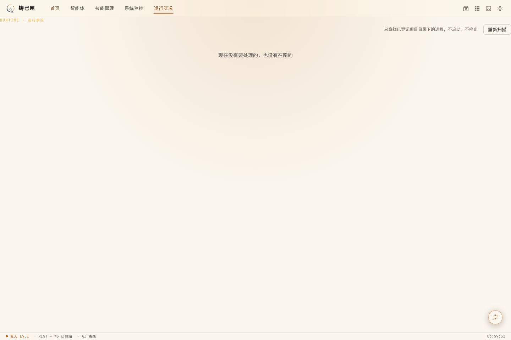

AC3。页头和「运行实况」标签上的数字，等于还没写下结果的阻塞审批条数。已经同意或拒绝的卡片仍留在页面上，直到下一次刷新，但不再计入数字。在跑再多也不计入。

造出方式：对外部 Agent 的待权限点「只放行这一次」，在 15 秒刷新前看页头；另一次打开时在跑有多条进程，页头仍是待批的条数。等级：Verified。

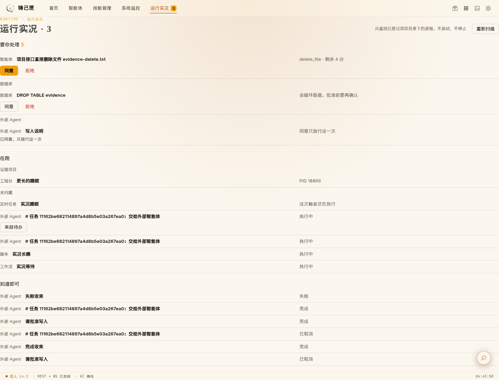

## 要你处理

同一会话的多条收在会话标题下。逐条同意或拒绝，没有批量同意。

AC4。紧急审批排在前面。整页只有第一张紧急审批的「同意」用金色填充。拒绝是朱红文字。破坏性工具（删除文件、会破坏数据的数据库语句）和剩余不足 2 分钟的待批算紧急。终端风险值为 high 或 highRisk 也算紧急。

造出方式：让智能体删除文件的审批保持未决定，同时放一条普通写入审批。亮色和暗色各看一次。暗色是给页面根节点加上 `html.dark`，并把主题记成 dark。等级：Verified。

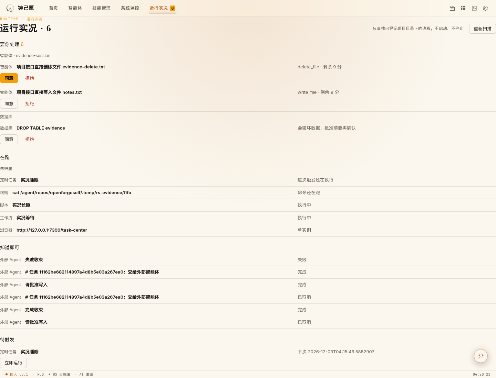

不足 2 分钟、且不是破坏性工具的待批也会把第一张同意变成金色。造出方式：对 `write_file` 走生产审批，等剩余时间掉到 1 分钟再截运行实况。卡片写明 `write_file` 和剩余 1 分，同意按钮带金色填充。等级：Verified。

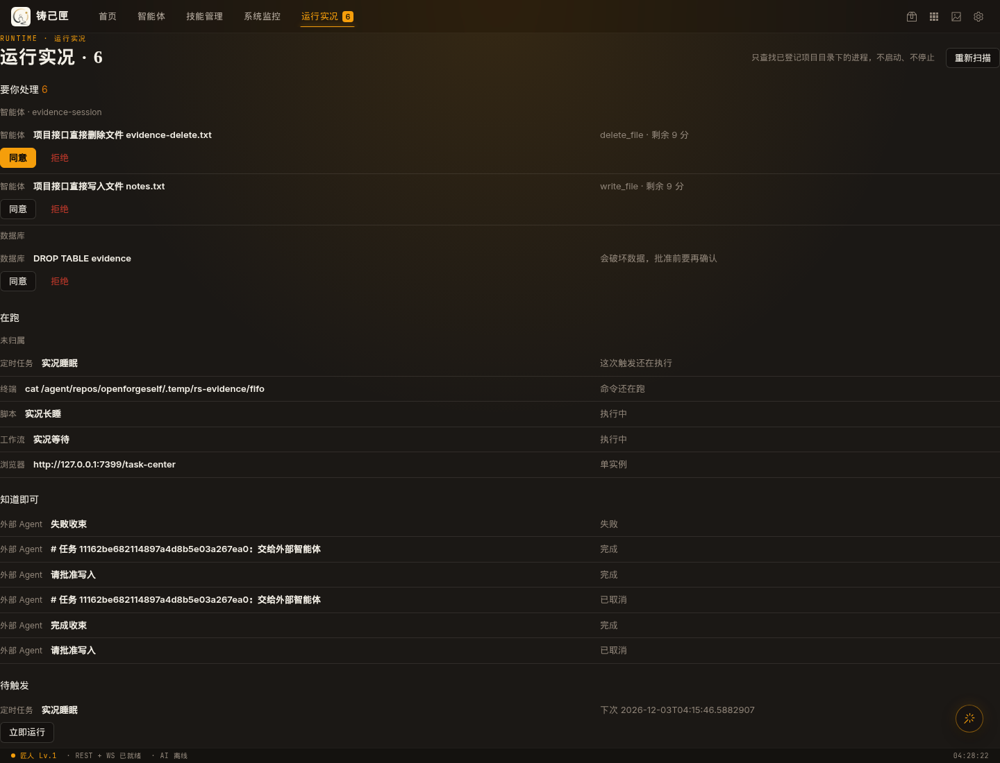

AC5。会破坏数据的同意先打开确认。对话框说明这条会破坏数据。取消不发决定，卡片仍待批。确认按钮是朱红实心，文案是「批准」。

造出方式：点删除文件或 `DROP TABLE` 那条的同意，先截对话框，再点取消，确认卡片还在。等级：Verified。

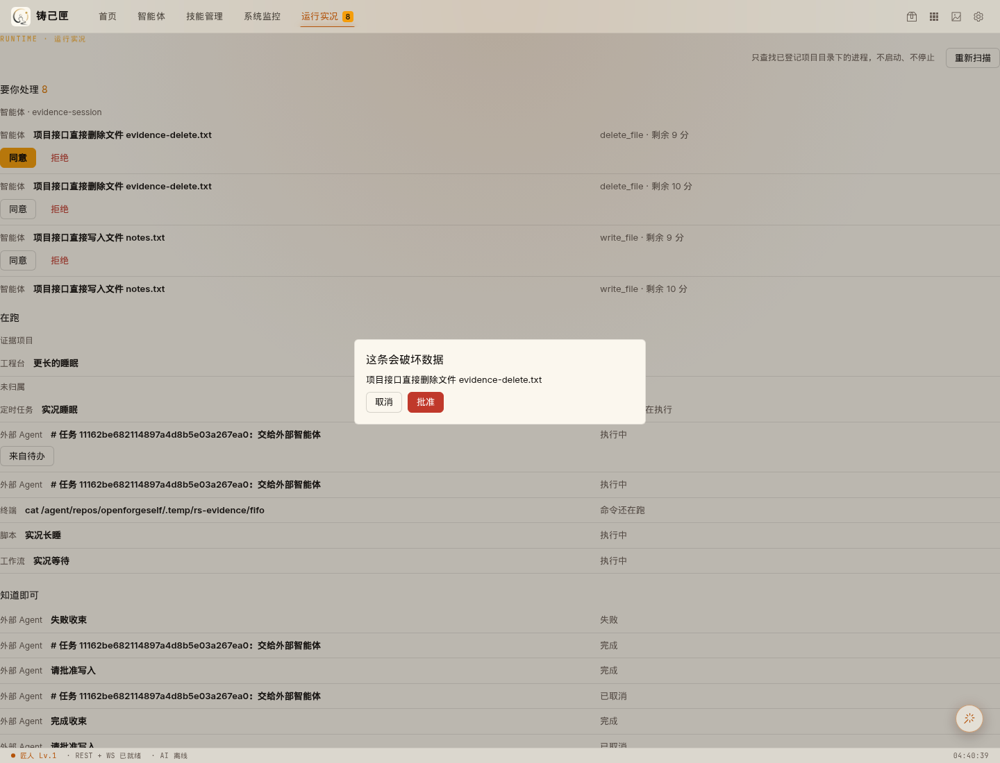

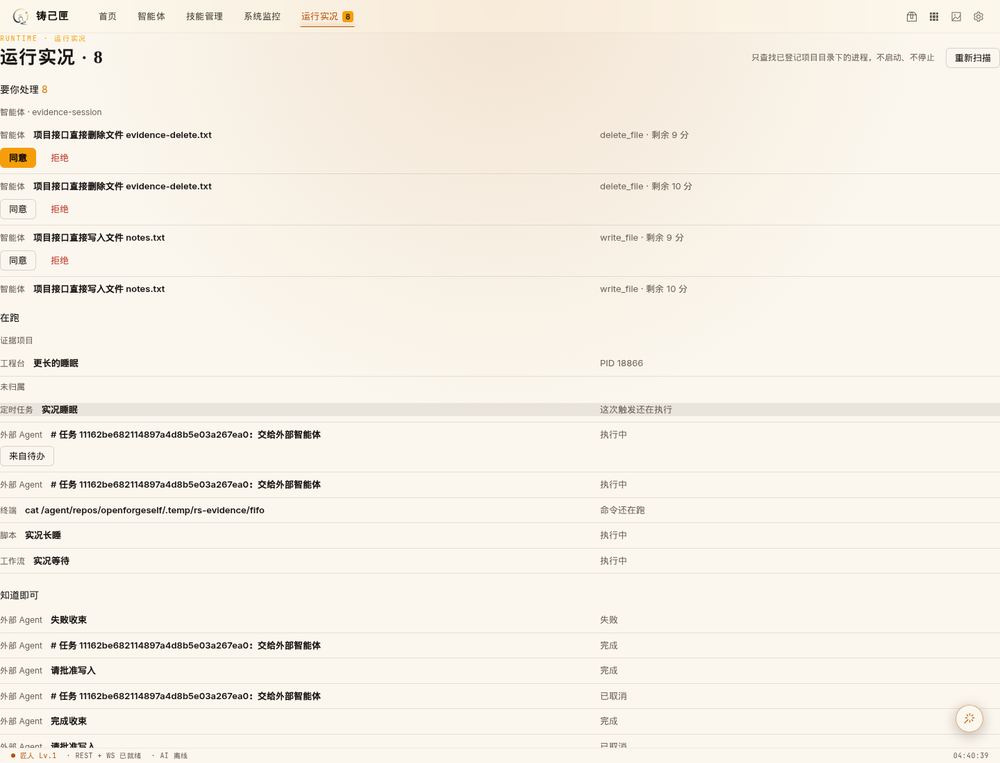

AC6。普通同意后，卡片留下「已同意，原任务继续」。不弹成功提示。

造出方式：对智能体写入文件的审批点同意，在下一次 15 秒刷新前截图。等级：Verified。

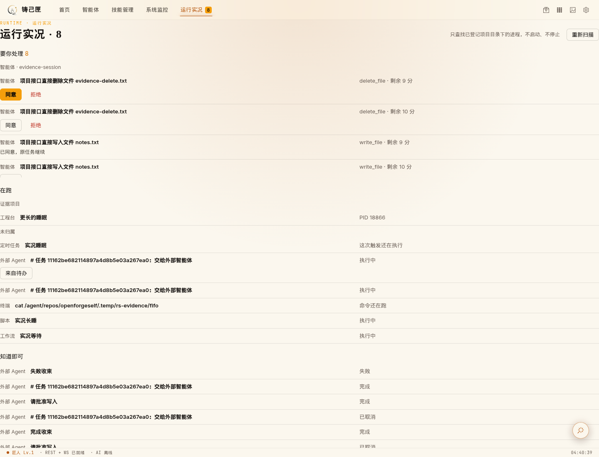

AC7。拒绝后，卡片留下「已拒绝」。决定失败时留下失败原因。

造出方式：对数据库的写入审批点拒绝。等级：Verified。

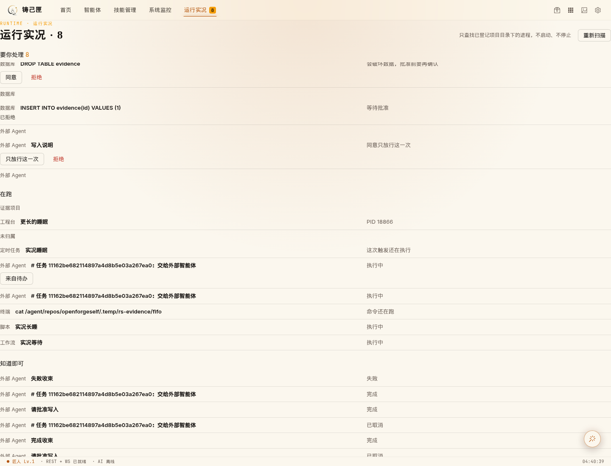

AC8。外部 Agent 的按钮文案是「只放行这一次」。点下去之后，卡片留下「已同意，只放行这一次」。

造出方式：外部 Agent 的权限配置把权限行送进审批，任务进入等待权限，再在运行实况点该按钮。等级：Verified。点之前的按钮见亮色来源图，点之后见 AC3 的图。

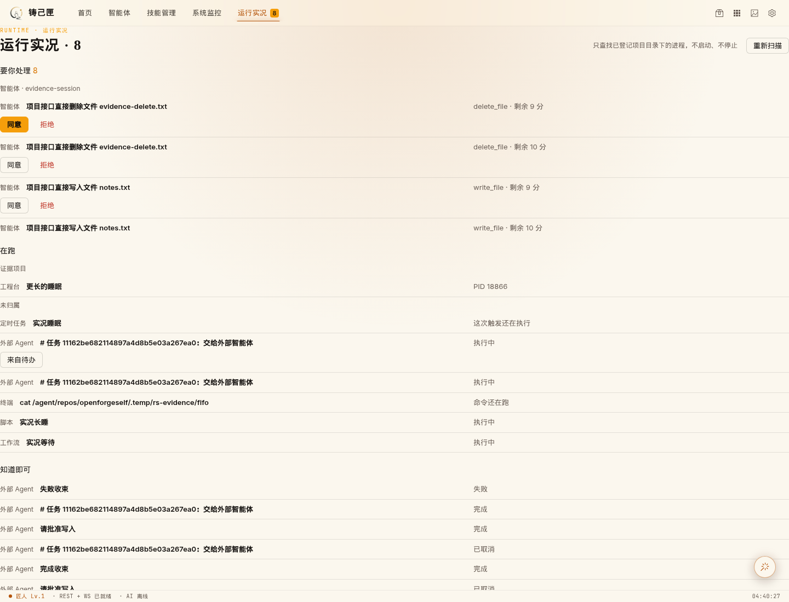

AC9。终端里等待批准的命令，卡片上写「本次宿主运行期间有效」。高风险命令出现在要你处理，不进在跑。

造出方式：终端权限模式设为写入需询问，提交一条高风险删除命令和一条写入命令，在宿主还活着时打开运行实况。等级：Verified。见亮色要你处理图中的终端卡片。宿主重启后，这些内存中的待批不再出现。

## 要续跑

AC11。智能体回合卡住、该会话没有待批、并且总览给出了续跑地址时，单独成组，只有「继续」。

造出方式：启用本机 mock 对话模型后提交计划任务。模型回复没有调用 `complete_step`，总览把该 Run 标成 stuck，并给出续跑地址。该会话没有待批。运行实况单独成组，只有「继续」。等级：Verified。

## 正在跑的来源

同一条执行只出现一次。待办委派出去的执行体就是外部 Agent 那条任务；能用 `agentTaskKey` 对上时，行上加「来自待办」，主点击仍是执行体。定时任务拉起的智能体回合若总览里已有 `scheduler:{taskId}`，只留智能体那一行。终端会话若已有待批，不再另开一条在跑。

AC10。在跑按项目名分组。对不上登记项目的放在「未归属」。这一段自己滚动，不截断，不出现「还有 N 条」。页面上没有项目筛选器。

造出方式：登记一个项目，在该目录留下多个尚未被其他来源代表的进程，再点重新扫描。等级：Verified。见重新扫描图。

| 来源 | 列表 | 点击 | 验收 |
| --- | --- | --- | --- |
| 智能体未结束回合和计划 Run | `GET /api/ai-agent/tasks-overview` | `/ai-agent?id=` 或 `/ai-agent?planId=` | AC12 |
| 外部 Agent 未结束任务 | `GET /api/agent-hub/tasks` | `/agent-hub?id=` | AC13 |
| 外部 Agent 待权限 | 状态为等待权限的任务 | 同一条任务链接 | AC8 |
| 智能终端里还在跑的命令 | 会话下的块状态为 running | `/smart-terminal?sessionId=` | AC14 |
| 工程台拉起且未结束的命令 | `GET /api/runs` | `/sems?id=&pid=` | AC15 |
| 脚本执行中 | `GET /api/script-runner/executions?status=Running` | `/script-runner?executionId=` | AC16 |
| 工作流正在执行 | `GET /api/workflows/executions?status=Running` | `/workflows?executionId=` | AC17 |
| 定时任务这次触发还在跑 | `GET /api/scheduler/running` | `/scheduler?taskId=`，只读 | AC18 |
| 待触发的定时任务 | `GET /api/scheduler/tasks` | 同一只读页 | AC18 |
| 文件工具目录扫描 | `GET /api/filetools/folders/scans` | `/file-tools?id=` | AC19 |
| 浏览器单实例已打开 | `GET /api/browser-use/session` | `/browser-use`，只读 | AC20 |
| 重新扫描发现、且上面还没有的进程 | `POST /api/runs/check`，只在按下按钮时 | 对上项目走工程台；只剩 pid 走 `/system-monitor?pid=` | AC21 / AC22 |

这些不收进在跑，因为它们不是一次正在执行的任务或命令：快捷链接、开发者工具、时钟、设计系统、首页、费用、记忆、设置、插件库、档案、提示词、技能、代码片段、聊天记录、MCP 服务器的启用状态、IM 通道的连接状态。IM 派出去的回合已经在智能体那一行。数据库没有「查询执行中」列表，只有待批。系统监控的全机进程表不搬进这一页。

### 智能体未结束回合

AC12。未结束的回合或计划 Run 应出现在在跑。对话用主参数 `id`，计划 Run 用 `planId`。当前导出页带上 `planId`（旧名 `runId` 仍接受）就打开该次执行记录。

造出方式：再登记一个指向本机慢响应接口的对话模型并启用。总览先出现 planning，随后出现 running。运行实况分别写出「规划中」和「执行中」。带 `planId` 打开的执行记录就是这一次卡住的 Run，左侧选中该条，右侧写出同一句卡住原因。等级：Verified。

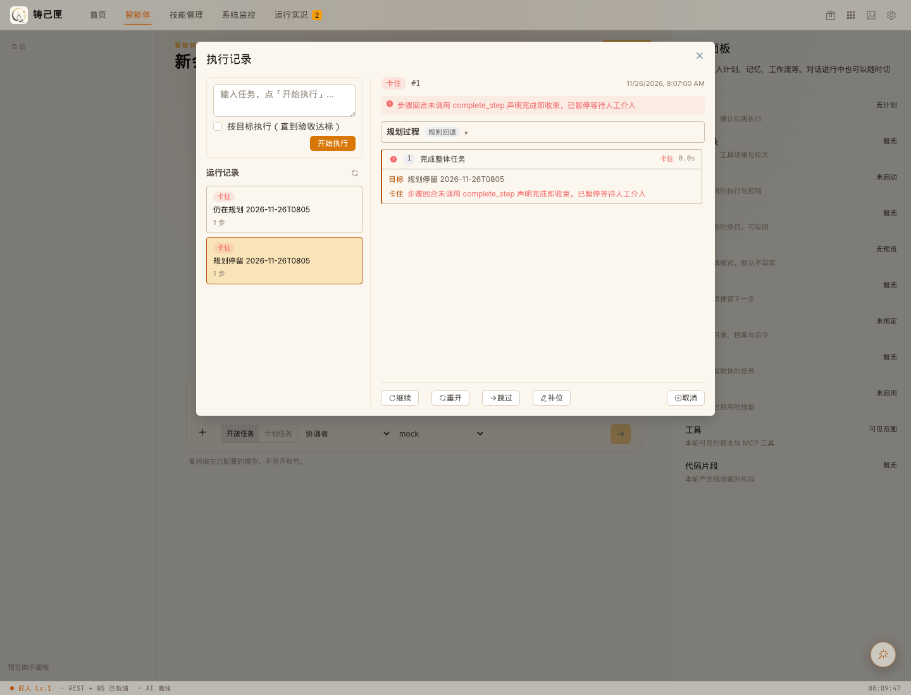

### 外部 Agent

AC13。未结束的外部任务出现在在跑。待办委派出去的那一行带次链接「来自待办」，指向 `/todo?todoId=`。主点击仍打开该任务。

造出方式：登记一个以 sleep 为可执行文件的 agent，本次新建任务后状态停在 Running。运行实况有这一行，点进 `/agent-hub?id=` 打开的仍是执行中。等级：Verified。

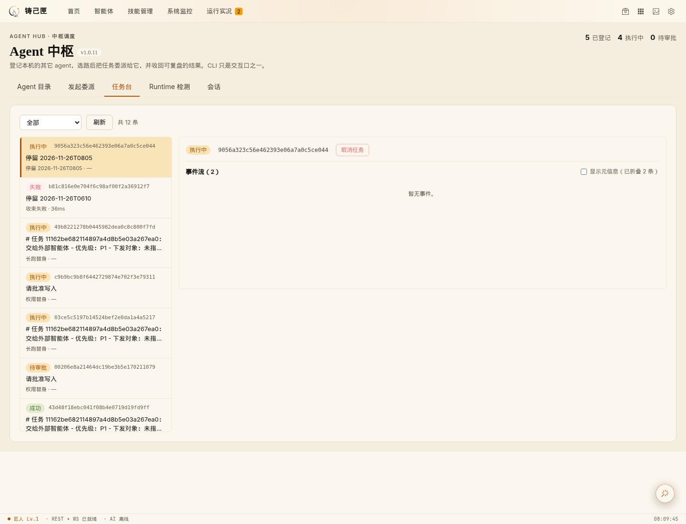

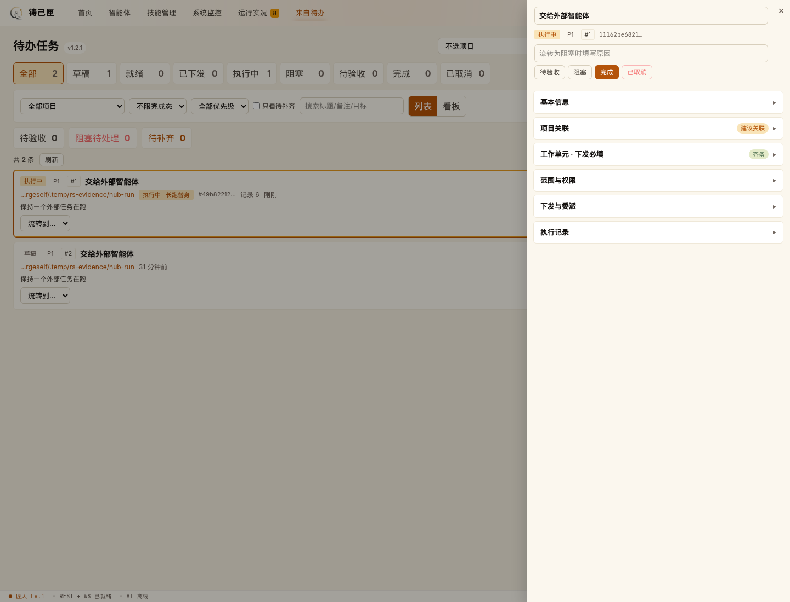

### 智能终端

AC14。还在跑的命令出现在在跑，点击进 `/smart-terminal?sessionId=`，来源页打开该会话和这条命令。已有待批的会话不再另开在跑。

造出方式：在终端里对一个没有写入端的管道执行读取，使块保持 running，再打开运行实况和来源页。等级：Verified。

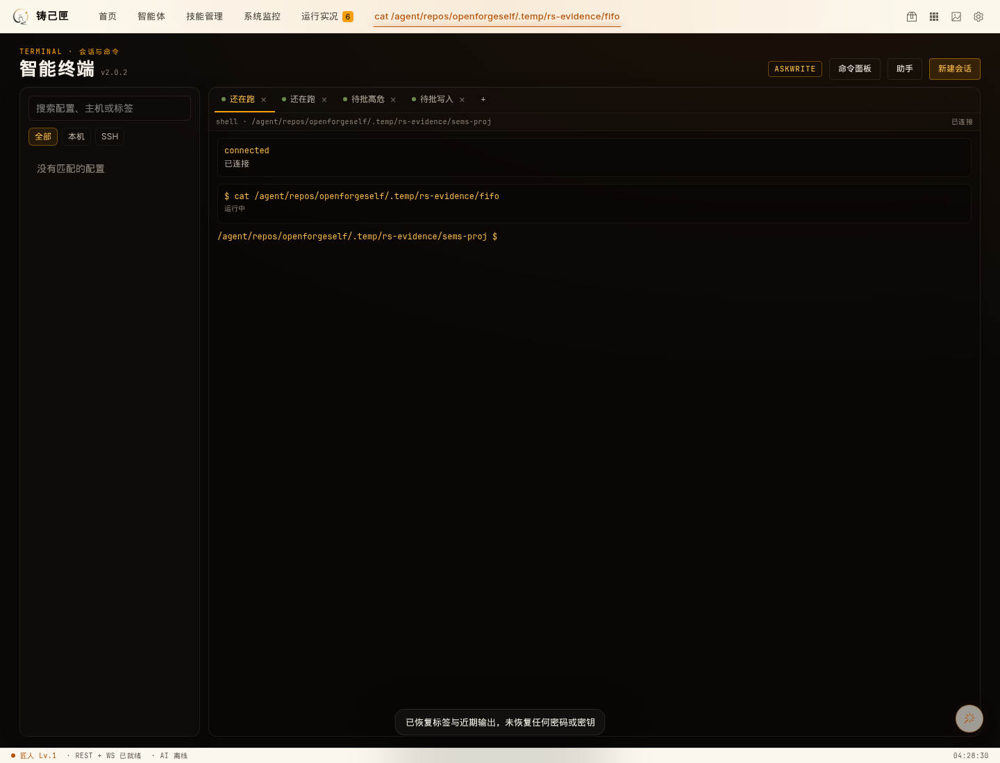

高风险待批的来源页会打开确认。造出方式：提交高风险命令后，从运行实况点进该会话。等级：Verified。

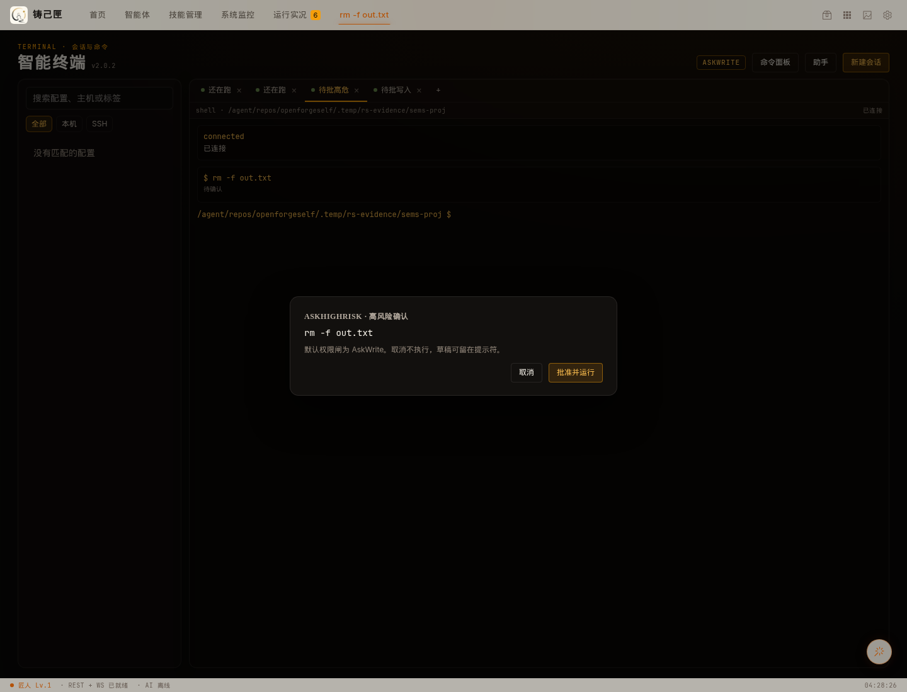

### 工程台

AC15。本面板拉起且未结束的命令出现在对应项目组。点击进 `/sems?projectId=&runId=`，来源页打开该项目并标出这条命令。

造出方式：在已登记项目里运行一条长时间睡眠的命令。等级：Verified。

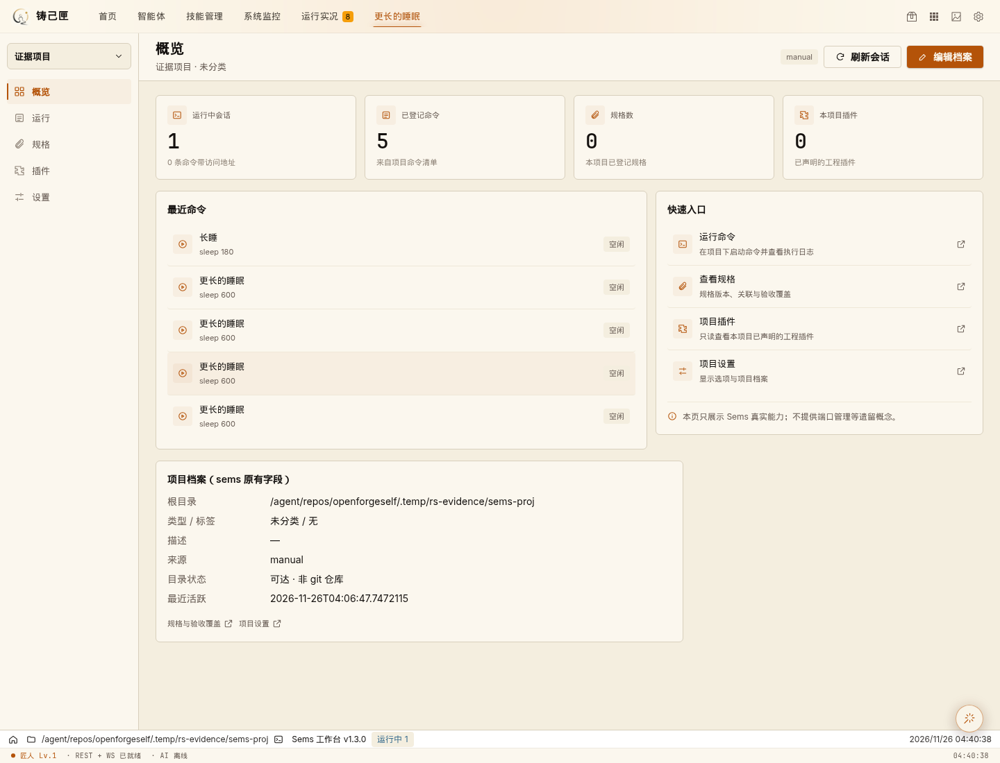

### 脚本与工作流

AC16。状态为执行中的脚本出现在在跑。点击后详情写出脚本名和「运行中」。

造出方式：创建一条长时间睡眠的脚本并执行，再从运行实况点进 `/script-runner?executionId=`。等级：Verified（详情打开且状态为运行中）。宿主重启后，这条记录仍被列表标成运行中，进程已经不在。截图看到的是接口返回的状态，不是重启之后新拉起的进程。

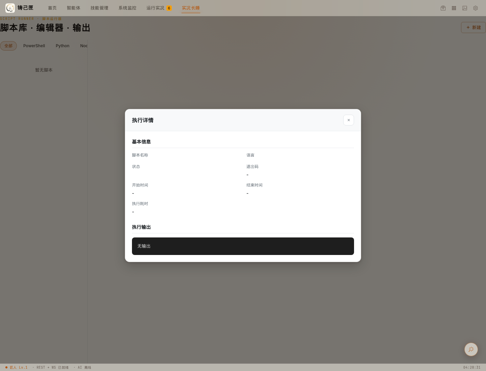

AC17。工作流执行中的点击进 `/workflows?executionId=`，详情状态为运行中。

造出方式：创建等待步骤并执行。等级：Verified，新鲜度与脚本相同。

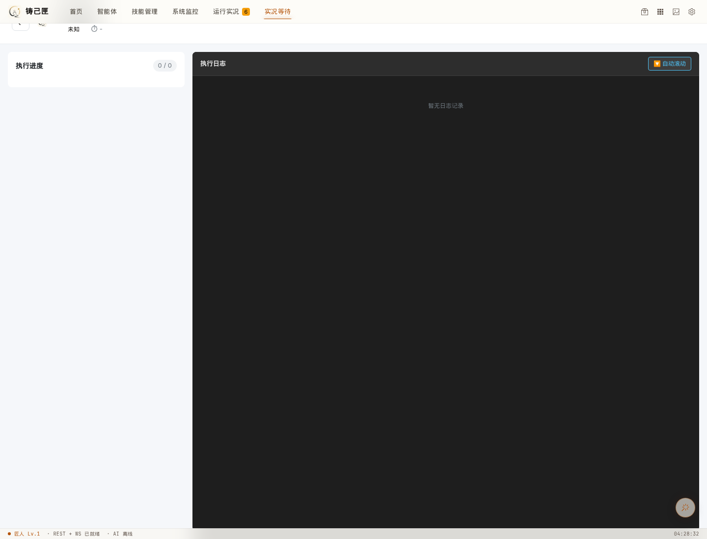

### 定时任务

AC18。这次触发还在执行的任务出现在在跑。已启用、这次没在跑的任务出现在「待触发」，可以点「立即运行」，也可以点进只读页 `/scheduler?taskId=`。

造出方式：建一个间隔触发、目标为长时间睡眠的系统命令，并另建一个已启用但未在跑的任务。等级：Verified。「这次还在跑」在宿主重启后仍可能留在运行列表里。只读页能按 `taskId` 打开任务。

待触发的文案在亮色来源图和重新扫描图里。

### 文件工具扫描

AC19。扫描进行中应出现一行，点击进 `/file-tools?id=`。列表只返回尚未结束的扫描。

造出方式：对一个约 250 万个空文件的目录发起扫描，在扫描结束前打开运行实况和文件工具。运行实况写「扫描中」。来源页按钮仍是「扫描中…」，状态为 Running，并写明下表是截至当前的部分结果。等级：Verified。文件工具的 HTTP 前缀是 `api/filetools`。

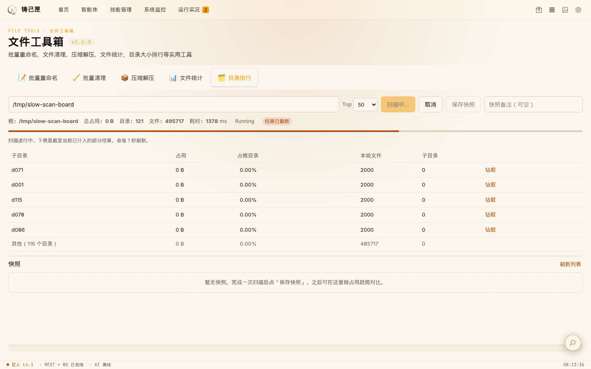

### 浏览器

AC20。浏览器单实例已打开时，在跑有一行，点击进只读页 `/browser-use`，页面写出已打开和当前地址。未打开时不占一行。

造出方式：让浏览器工具打开运行实况自身的地址，再从运行实况点进只读页。等级：Verified。这张图来自第一次验证栈。后来再次打开浏览器失败，没有重拍。

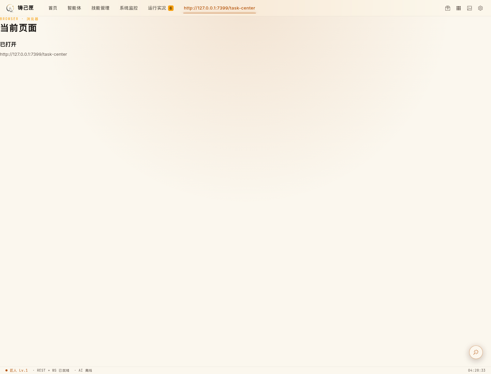

### 重新扫描

按钮旁的说明是「只查找已登记项目目录下的进程，不启动、不停止」。只有点击才调用 `POST /api/runs/check`。打开页面和 15 秒定时器不扫进程。

AC21。对上登记项目、且还没有被上面来源代表的进程，出现在该项目组，来源写「进程」。点击进 `/sems?projectId=&runId=`。

造出方式：在已登记项目目录启动一个独立的长时间睡眠进程，打开运行实况后只点「重新扫描」。等级：Verified。

查询列表必须带上最近一次扫描的结果。只在扫描响应里返回、随后的列表又丢掉，页面上就看不到。这一点有回归测试。

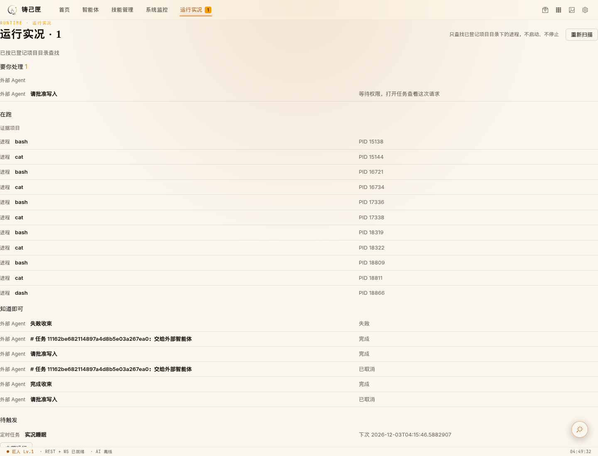

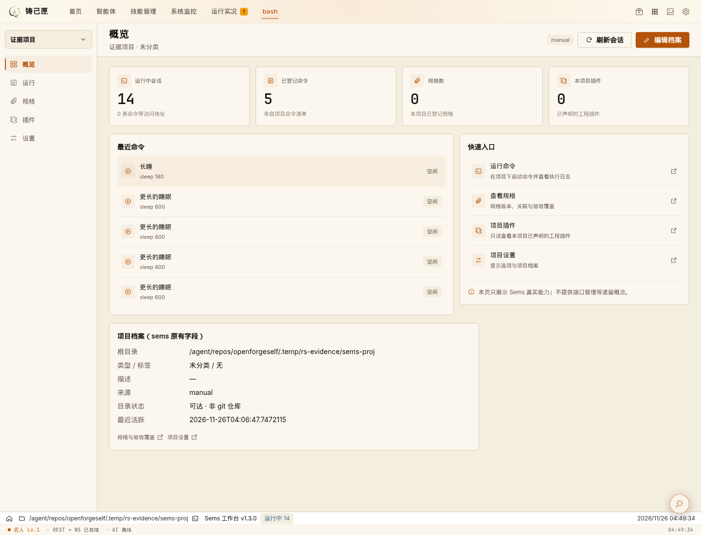

AC22。重新扫描后，落在已登记项目目录下、但类型对不上项目、只剩 pid 的进程出现在运行实况，项目名写「未归属」。点击进 `/system-monitor?id=`，值是 pid，系统监控高亮该进程。仍只查已登记项目目录，不把全机进程表搬进来，不启动也不停止。

造出方式：把项目类型改成 frontend，在该目录启动 sleep。frontend 不接受 sleep，扫描仍能看到它，列表里 projectId 为 0。等级：Verified。

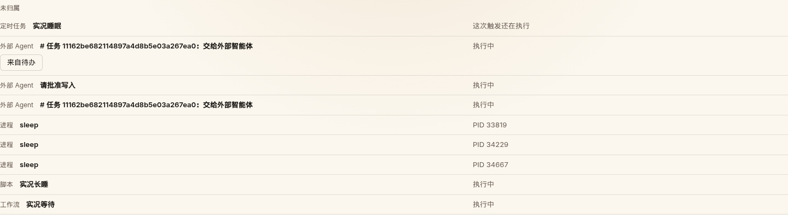

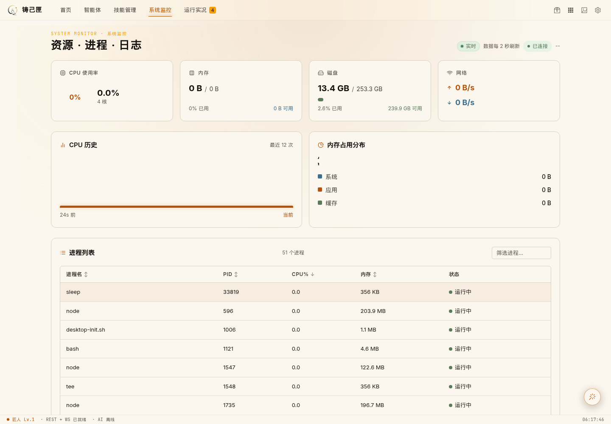

## 知道即可

已结束的外部任务和智能体回合最多 20 条，失败排在前面。点击进对应来源。

造出方式：让外部任务分别失败、完成、取消，再打开运行实况。等级：Verified。见亮色要你处理图和重新扫描图里的「知道即可」。失败收束排在完成之前。

## 深链

AC26。点一行要带着查询参数打开对应详情，而不是只改地址栏。

各来源页以前各自起参数名。智能体的 `runId` 是计划 Run，工程台的 `runId` 实际是进程 pid，同一个名字指两种东西。仓内没有一份所有页面共用的深链约定，所以打开「这一条对话 / 任务 / 项目 / 页签 / 执行」的主参数统一叫 `id`。同一页还要定位另一种东西时，用能看出种类的第二参数，不再叫 `id`。运行实况只发出新名。解析端仍接受旧名，旧链接不会失效。

| 页面 | 主参数 `id` 打开什么 | 第二参数 | 仍接受的旧名 |
| --- | --- | --- | --- |
| `/ai-agent` | 这一条对话 | `planId`：计划 Run | `session`、`runId` |
| `/agent-hub` | 这一条外部任务 | 无 | `taskId` |
| `/smart-terminal` | 这一条终端会话 | `approvalId`：会话里的那条待批 | `sessionId`、`st_session` |
| `/sems` | 这个项目 | `pid`：这次进程 | `projectId`、`runId` |
| `/script-runner` | 这一次脚本执行 | 无 | `executionId` |
| `/workflows` | 这一次工作流执行 | 无 | `executionId` |
| `/scheduler` | 这一条定时任务 | 无 | `taskId` |
| `/file-tools` | 这一次目录扫描 | 无 | `scanId` |
| `/db-admin` | 这一条写入待批 | 无 | `approvalId` |
| `/todo` | 这一条待办 | 无 | `todoId` |
| `/system-monitor` | 这个进程，值是 pid | 无 | `pid` |
| `/browser-use` | 无单独一条的标识 | 无 | 无 |

| 来源 | 运行实况发出的查询 | 打开后能看到 | 图 | 等级 |
| --- | --- | --- | --- | --- |
| 智能体待批 | `id` | 该会话标题和待批卡片 | 下图 | Verified |
| 数据库待批 | `id` | 写入审批对话框 | 下图 | Verified |
| 终端在跑 | `id` | 该会话和命令 | 终端节 | Verified |
| 终端待批 | `id` 与 `approvalId` | 高风险确认 | 终端节 | Verified |
| 外部 Agent | `id` | 该任务 | 下图 | 打开已验证；本轮新建的任务已失败，执行中未验证 |
| 待办 | `id` | 被派发的待办 | 外部 Agent 节 | Verified |
| 工程台命令 | `id` 与 `pid` | 该项目和命令 | 工程台节 | Verified |
| 扫描到的进程 | `id` 与 `pid` | 工程台 | 重新扫描节 | Verified |
| 脚本 | `id` | 执行详情 | 脚本节 | Verified |
| 工作流 | `id` | 执行详情 | 工作流节 | Verified |
| 定时任务 | `id` | 只读任务页 | 定时任务节 | Verified |
| 浏览器 | 无任务 id | 已打开 | 浏览器节 | Verified |
| 文件扫描 | `id` | 该次扫描 | 文件工具扫描节 | Verified |
| 对不上项目的进程 | `id`，值是 pid | 系统监控里的该进程 | 系统监控节 | Verified |
| 计划 Run | `planId` | 该次执行记录 | 智能体未结束回合节 | Verified |

智能体的当前页面会读取主参数 `id`（旧名 `session` 仍接受），把该会话下仍待决定的工具审批放进对话。等级：Verified。

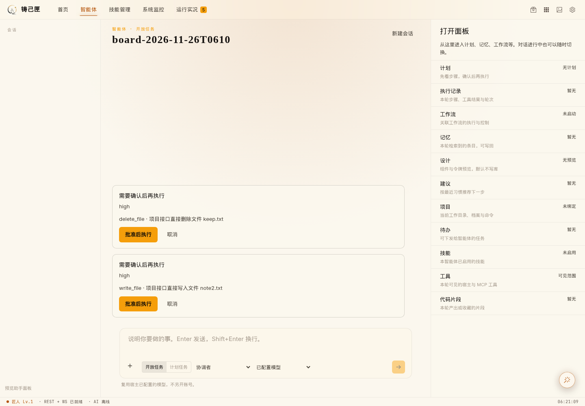

数据库的主参数 `id`（旧名 `approvalId` 仍接受）打开写入审批。破坏性语句在来源页也会标出不可恢复。等级：Verified。

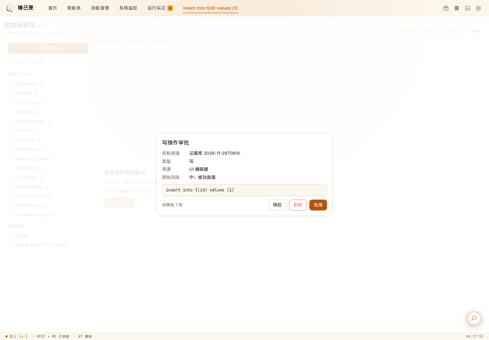

外部 Agent 的主参数 `id`（旧名 `taskId` 仍接受）打开该任务。本轮新建的任务在打开时已经失败，不是执行中。等级：打开已验证，执行中未验证。

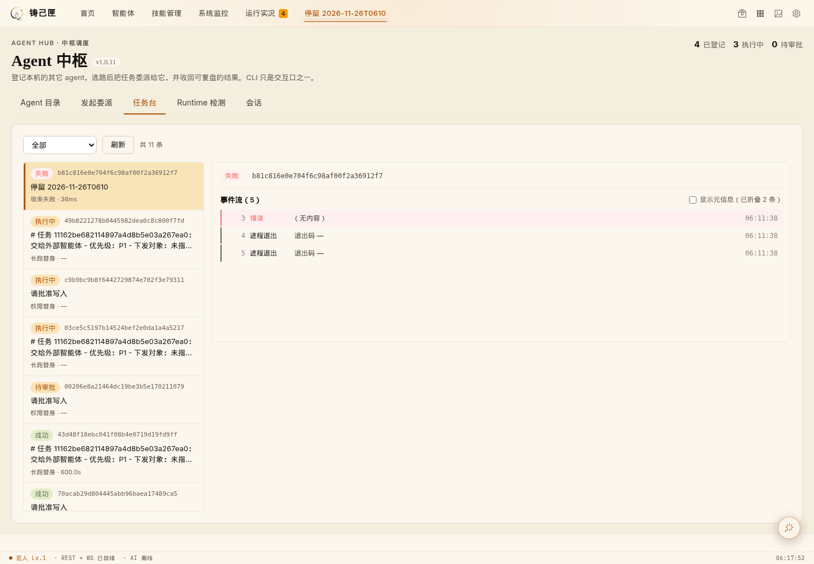

## 访问密钥与未启用

AC23。去掉访问密钥再打开页面时，需要密钥的那一路显示「需要访问密钥」，其他路继续显示。

造出方式：清掉浏览器里的访问密钥后打开 `/task-center`。等级：Verified。实测边界：定时任务、脚本、工作流这三路的接口在本宿主上不要求密钥，所以它们仍列出；智能体的待批列表也不要求密钥，匿名页上仍可能看到智能体卡片。数据库、终端、外部 Agent、工程台、文件工具、浏览器会标「需要访问密钥」。

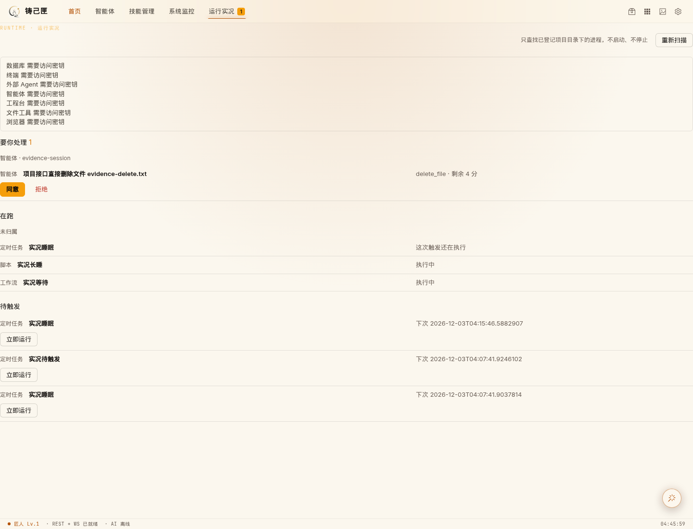

AC24。某一路返回 404 时，只标这一路「未启用」。

造出方式：禁用浏览器插件后再打开运行实况，看到「浏览器 未启用」，然后立刻重新启用。等级：Verified。

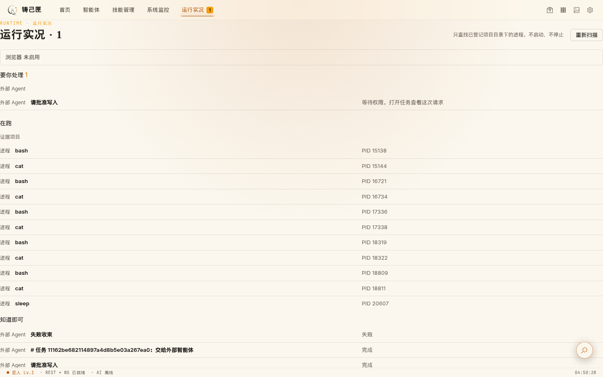

AC25。要你处理和在跑在亮色、暗色下都看过。暗色截图见页头节。另一次亮色来源全貌见外部 Agent 节的图，暗色来源全貌如下。等级：Verified。

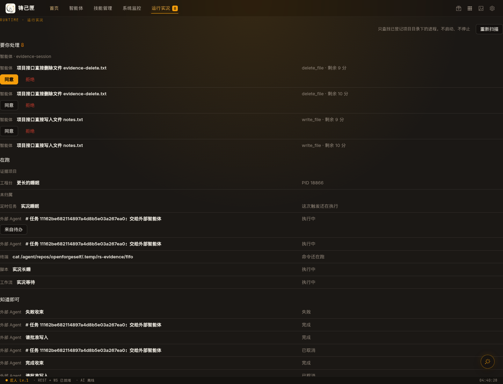

## 决定仍回原处

| 来源 | 决定 |
| --- | --- |
| 智能体 | `POST /api/ai-agent/approvals/{id}/decide`，body `{ approved }`。跨会话列表是 `GET /api/ai-agent/approvals/pending` |
| 数据库 | `POST /api/db-admin/approvals/{id}/resolve`，body `{ decision, confirmDestructive }` |
| 终端 | `POST /api/smart-terminal/approvals/{id}/resolve`，body `{ decision }` |
| 外部 Agent | `POST /api/agent-hub/tasks/{id}/permissions/{requestId}/resolve`，body `{ allowed, note }` |

分类在 `ForgeSelf.Web/src/services/runtimeBoard.ts`。取数在 `ForgeSelf.Web/src/services/runtimeBoardApi.ts`。页面是 `ForgeSelf.Web/src/views/TaskCenterView.vue`。

## 规范核对

设计 token、按钮、空态、深链和「不改 IM、不新建插件」的核对表在工件 `06-review.md`。不符合的已经改过代码后再截图。本页不放亮暗色切换。
